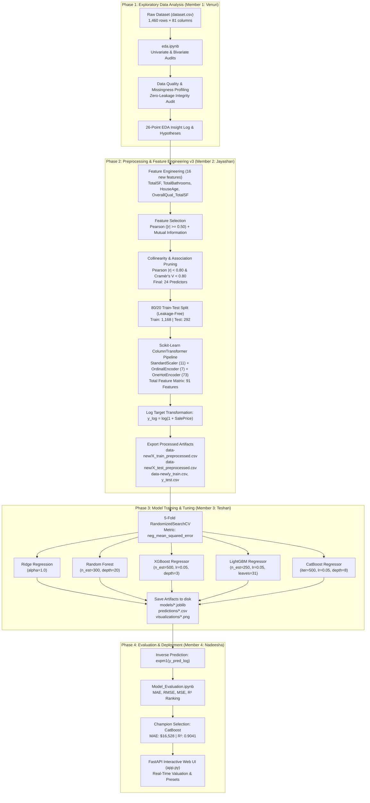

# Ames Housing Price Prediction: Comprehensive University Final Project Report
**Course / Project**: Advanced Machine Learning & Predictive Analytics  
**Institution**: University Project Submission  
**Repository**: [VenuriDampahalage/ames-housing-price-prediction](https://github.com/VenuriDampahalage/ames-housing-price-prediction)  
**Project Version**: 3.0 (Production-Ready Release)  
**Date of Submission**: October 2026  

---

## Executive Summary

The objective of this project is to develop an enterprise-grade, highly accurate, and interpretable machine learning system to predict residential property sale prices in Ames, Iowa. Using the authoritative Ames Housing Dataset (comprising 1,460 property sales across 81 heterogeneous attributes), our team executed an end-to-end data science lifecycle. This encompassed comprehensive exploratory data analysis, domain-specific feature engineering, rigorous data leakage prevention, multicollinearity and association pruning, hyperparameter optimization across five diverse regression paradigms, and model deployment via an interactive FastAPI web application.

Through rigorous 5-fold cross-validation and evaluation on a 20% strictly held-out test partition ($n = 292$), the **CatBoost Regressor** was selected as the overall champion model, achieving a **Mean Absolute Error (MAE) of $16,528.23**, a **Root Mean Squared Error (RMSE) of $27,116.86**, a **log-scale Mean Squared Error (MSE) of 0.0206**, and an **$R^2$ score of 0.9041**. The companion **XGBoost Regressor** delivered comparable performance with an $R^2$ of **0.9073** and RMSE of **$26,670.54**. 

---

## 1. Project Team & Division of Responsibilities

To ensure academic rigor and modular engineering, the project was partitioned into four distinct phases, each led by a designated team member:

| Member | Full Name & GitHub Identity | Primary Responsibility | Core Deliverables / Artifacts |
|---|---|---|---|
| **Member 1** | **Venuri Dampahalage** (`VenuriDampahalage`) | **Exploratory Data Analysis (EDA)** | [`eda.ipynb`](file:///d:/Projects_New/ames-housing-price-prediction/eda.ipynb), 26-Point EDA Insight Log, Data Quality Audit, Univariate/Bivariate/Multivariate Analysis |
| **Member 2** | **Jayashan Manodya** (`JayashanManodya`) | **Data Preprocessing & Feature Engineering (v3)** | [`preprocessV3.ipynb`](file:///d:/Projects_New/ames-housing-price-prediction/preprocessV3.ipynb), Preprocessing Pipelines, 16 Engineered Features, Multicollinearity/Association Pruning, [`data-new/`](file:///d:/Projects_New/ames-housing-price-prediction/data-new) exports |
| **Member 3** | **Teshan** (`teshanDev` / `mathinthateshan`) | **Model Training & Hyperparameter Tuning** | [`Model_Training.ipynb`](file:///d:/Projects_New/ames-housing-price-prediction/Model_Training.ipynb), 5-Fold RandomizedSearchCV, 5 Model Pipelines, [`models/`](file:///d:/Projects_New/ames-housing-price-prediction/models), [`predictions/`](file:///d:/Projects_New/ames-housing-price-prediction/predictions), Diagnostic Plots |
| **Member 4** | **Nadeesha Malshan** (`malshannandanayaka`) | **Model Evaluation, Benchmarking & Web Deployment** | [`Model_Evaluation.ipynb`](file:///d:/Projects_New/ames-housing-price-prediction/Model_Evaluation.ipynb), Metric Comparison Framework, Champion Selection, [`app.py`](file:///d:/Projects_New/ames-housing-price-prediction/app.py) FastAPI Web UI |

---

## 2. End-to-End System Architecture

The following diagram illustrates the complete data flow, transformation stages, and component handoffs across the four team members:



---

## 3. Exploratory Data Analysis (EDA) — Led by Member 1 (Venuri Dampahalage)

The exploratory analysis conducted in [`eda.ipynb`](file:///d:/Projects_New/ames-housing-price-prediction/eda.ipynb) provided the empirical grounding for all subsequent pipeline engineering.

### 3.1 Target Variable Analysis (`SalePrice`)
- **Distribution Characteristics**: The raw `SalePrice` exhibits positive right-skewness ($\text{skewness} = 1.88$) and heavy kurtosis ($\text{kurtosis} = 6.54$). The mean price is **$180,921.20**, while the median is **$163,000.00** (standard deviation = **$79,442.50**).
- **Transformation Imperative**: The heavy tail violates classical linear regression normality assumptions and inflates squared residuals on high-value properties. Applying natural log transformation ($\ln(1 + \text{SalePrice})$) yields a near-normal distribution with skewness reduced to **0.12**, stabilizing variance (homoscedasticity) and aligning loss minimization with percentage errors (RMSLE).

### 3.2 Data Quality and Missingness Audit
The analysis systematically dissected all 81 features to differentiate between random data absence and intentional structural encoding:
- **Structural Missingness ("NA" as a Valid Physical Category)**:
  - `PoolQC` (99.52% NA): Indicates property lacks a pool.
  - `MiscFeature` (96.30% NA): Indicates no miscellaneous feature (e.g., tennis court, elevator).
  - `Alley` (93.77% NA): Indicates no alley access.
  - `Fence` (80.75% NA): Indicates no fence enclosure.
  - `FireplaceQu` (47.26% NA): Indicates property has zero fireplaces.
  - `GarageType`, `GarageFinish`, `GarageQual`, `GarageCond` (~5.5% NA): Indicates property lacks a garage.
  - `BsmtQual`, `BsmtCond`, `BsmtExposure`, `BsmtFinType1`, `BsmtFinType2` (~2.5% NA): Indicates absence of a basement.
- **Genuine Random Missingness**:
  - `LotFrontage` (17.74% missing): Physical distance from street is missing randomly; correlated with parcel size and lot configuration.
  - `MasVnrType` and `MasVnrArea` (0.55% missing): Imputed as None / 0.
  - `Electrical` (1 record missing): Imputed with the dominant mode (`SBrkr`).

### 3.3 Outlier & Anomaly Identification
- **Extreme Leverage Outliers**: Identified two notable properties in Edwards neighborhood with living areas exceeding 4,000 sq ft (`GrLivArea > 4000`) that sold at unusually low prices (<$200,000). These partial sales / atypical commercial-like parcels can distort linear hyperplanes if unregularized.
- **Data Leakage Safeguard**: Member 1 established an explicit rule in Section 3.7 confirming that no statistical properties or global parameters from the test set would be used during EDA, establishing strict train/test hygiene.

### 3.4 Key Correlations & Relationships
- **Dominant Continuous Predictors**: Above-grade living area (`GrLivArea`, $r = 0.709$), Total basement square footage (`TotalBsmtSF`, $r = 0.614$), First-floor square footage (`1stFlrSF`, $r = 0.606$), and Garage capacity (`GarageCars`, $r = 0.640$).
- **Dominant Ordinal/Categorical Predictors**: Overall material and finish quality (`OverallQual`, $r = 0.791$), Neighborhood location (medians ranging from $88,000 in Meadow Village to $315,000 in Northridge Heights), Exterior Quality (`ExterQual`), and Kitchen Quality (`KitchenQual`).
- **Severe Multicollinearity Red Flags**: Observed intense pairwise correlations:
  - `GarageCars` $\leftrightarrow$ `GarageArea` ($r = 0.882$)
  - `YearBuilt` $\leftrightarrow$ `GarageYrBlt` ($r = 0.826$)
  - `GrLivArea` $\leftrightarrow$ `TotRmsAbvGrd` ($r = 0.825$)
  - `1stFlrSF` $\leftrightarrow$ `TotalBsmtSF` ($r = 0.820$)

---

## 4. Preprocessing & Feature Engineering (v3) — Led by Member 2 (Jayashan Manodya)

The pipeline implemented in [`preprocessV3.ipynb`](file:///d:/Projects_New/ames-housing-price-prediction/preprocessV3.ipynb) transformed the raw dataset into a robust, leak-free, 91-dimensional numerical matrix.

### 4.1 Domain-Specific Feature Engineering (16 Features Created)
To capture real-world appraisal principles, Member 2 synthesized 16 new domain features:

| # | Engineered Feature Name | Mathematical Definition | Domain / Economic Rationale |
|---|---|---|---|
| 1 | `TotalSF` | $\text{TotalBsmtSF} + \text{1stFlrSF} + \text{2ndFlrSF}$ | True volumetric enclosed finished living space of the entire structure. |
| 2 | `TotalPorchSF` | $\text{OpenPorchSF} + \text{EnclosedPorch} + \text{3SsnPorch} + \text{ScreenPorch}$ | Aggregate outdoor leisure square footage. |
| 3 | `TotalBathrooms` | $\text{FullBath} + 0.5\times\text{HalfBath} + \text{BsmtFullBath} + 0.5\times\text{BsmtHalfBath}$ | Industry-standard total effective bathroom count. |
| 4 | `HouseAge` | $\text{YrSold} - \text{YearBuilt}$ | Physical age of structure at sale date; directly models physical depreciation. |
| 5 | `RemodAge` | $\text{YrSold} - \text{YearRemodAdd}$ | Elapsed years since modern structural renovation. |
| 6 | `TotalFinishedBsmtSF` | $\text{BsmtFinSF1} + \text{BsmtFinSF2}$ | Habitable, finished subterranean square footage. |
| 7 | `TotalLivingSF` | $\text{GrLivArea} + \text{TotalFinishedBsmtSF}$ | Effective conditioned living area across all vertical tiers. |
| 8 | `HasGarage` | $\mathbb{I}(\text{GarageArea} > 0)$ | Binary flag for presence of dedicated vehicle parking. |
| 9 | `HasBasement` | $\mathbb{I}(\text{TotalBsmtSF} > 0)$ | Binary flag for presence of subterranean foundation. |
| 10 | `HasFireplace` | $\mathbb{I}(\text{Fireplaces} > 0)$ | Binary amenity indicator for secondary heating / comfort. |
| 11 | `HasPool` | $\mathbb{I}(\text{PoolArea} > 0)$ | Binary luxury indicator for in-ground swimming facilities. |
| 12 | `GarageAge` | $\text{YrSold} - \text{GarageYrBlt}$ | Elapsed age of garage structure. |
| 13 | `OverallQual_GrLivArea` | $\text{OverallQual} \times \text{GrLivArea}$ | Interaction: premium craftsmanship scaling with above-grade space. |
| 14 | **`OverallQual_TotalSF`** | $\text{OverallQual} \times \text{TotalSF}$ | **Highest-performing single predictor ($r = 0.88$)**: Compounding valuation of quality and total space. |
| 15 | `OverallCond_HouseAge` | $\text{OverallCond} / (\text{HouseAge} + 1)$ | Interaction: maintenance resilience against chronological aging. |
| 16 | `OutdoorArea` | $\text{LotArea} - (\text{1stFlrSF} + \text{GarageArea})$ | *Dropped after audit*: Lot boundary noise produced erratic variance. |

### 4.2 Data Anomaly Remediation
- **Negative `RemodAge` Anomaly**: In one instance, a property's record showed a remodeling completion year recorded 1 year after the recorded contract closing date ($\text{YrSold} < \text{YearRemodAdd}$), producing a negative age of -1. Member 2 applied a lower-bound clipping threshold: $\text{RemodAge} = \max(0, \text{RemodAge})$.
- **Pruning `OutdoorArea`**: Statistical audit demonstrated that raw `LotArea` variation overwhelmed building footprint subtraction, adding noise rather than predictive signal. It was dropped in Section 6.19.

### 4.3 Feature Selection & Multicollinearity Pruning
To prevent the curse of dimensionality and tree splitting instability, candidate selection followed a two-stage filter:
1. **Numerical Selection via Pearson Correlation**:
   - Filter threshold: $|r| \ge 0.50$ against `SalePrice`.
   - Top candidates selected: `OverallQual_TotalSF` (0.88), `OverallQual` (0.79), `TotalSF` (0.78), `GrLivArea` (0.71), `GarageCars` (0.64), `TotalBathrooms` (0.63), `TotalBsmtSF` (0.61), `1stFlrSF` (0.61), `FullBath` (0.56), `TotRmsAbvGrd` (0.53), and `HouseAge` (-0.52).
2. **Categorical Selection via Mutual Information Regression ($MI$)**:
   - Filter threshold: $MI \ge 0.10$.
   - Top candidates selected: `Neighborhood` (0.54), `BsmtQual` (0.32), `KitchenQual` (0.32), `ExterQual` (0.32), `GarageFinish` (0.27), `FireplaceQu` (0.21), `HeatingQC` (0.17), `Foundation` (0.17), `GarageType` (0.15), `Exterior2nd` (0.14), `MSSubClass` (0.14), `BsmtFinType1` (0.13), and `MasVnrType` (0.10).
3. **Multicollinearity & Association Redundancy Pruning**:
   - Numerical collinear pairs with $|r| \ge 0.80$ were inspected: `GarageArea` was dropped in favor of `GarageCars` (higher correlation, discrete stability); `1stFlrSF` and `TotalBsmtSF` were retained alongside `TotalSF` due to additive interaction preservation.
   - Categorical association pairs with Cramér's $V \ge 0.80$ were inspected: `Exterior1st` ($V = 0.759$ with `Exterior2nd`) was pruned, retaining `Exterior2nd` which captured higher mutual information.
   - **Final Optimal Feature Set**: Exactly **24 selected predictors** + 1 target variable (`SalePrice`).

### 4.4 Scikit-Learn `ColumnTransformer` Pipeline Architecture
Member 2 constructed an isolated transformation pipeline fitted strictly on `X_train` (80% split, $n = 1,168$) and applied to `X_test` (20% split, $n = 292$):
- **Numerical Pipeline (`StandardScaler`)**: 11 continuous features transformed via $z = \frac{x - \mu}{\sigma}$.
- **Ordinal Pipeline (`OrdinalEncoder`)**: 7 features encoded into monotonic integer ranks $[0, \dots, 5]$ preserving domain hierarchy:
  - `BsmtQual`, `KitchenQual`, `ExterQual`, `FireplaceQu`, `HeatingQC`: `['None', 'Po', 'Fa', 'TA', 'Gd', 'Ex']`
  - `GarageFinish`: `['None', 'Unf', 'RFn', 'Fin']`
  - `BsmtFinType1`: `['None', 'Unf', 'LwQ', 'Rec', 'BLQ', 'ALQ', 'GLQ']`
- **Nominal Pipeline (`OneHotEncoder`)**: 6 nominal features (`Neighborhood` [25], `MSSubClass` [15], `Exterior2nd` [16], `GarageType` [7], `Foundation` [6], `MasVnrType` [4]) expanded into 73 binary indicator flags with `handle_unknown='ignore'`.
- **Target Transformation**: $y_{\text{train\_log}} = \log(1 + y_{\text{train}})$ and $y_{\text{test\_log}} = \log(1 + y_{\text{test}})$.
- **Total Processed Modeling Space**: Exactly **91 columns**.

---

## 5. Comprehensive Dataset & Data Dictionary

### 5.1 Pre-Encoding Feature Dictionary (24 Selected Features + Target)

| # | Feature Name | Origin | Category | Type | Physical Meaning & Measurement Unit | Predictive Rank / Metric |
|---|---|---|---|---|---|---|
| **1** | `OverallQual_TotalSF` | Engineered | Numerical | Continuous | Compound interaction: `OverallQual` $\times$ `TotalSF`. Captures luxury pricing scaling non-linearly with massive square footage. | Pearson $r = 0.88$ (Rank #1) |
| **2** | `OverallQual` | Raw | Numerical | Discrete | Overall material and finish rating of the property (1 = Very Poor, 10 = Very Excellent). | Pearson $r = 0.79$ (Rank #3) |
| **3** | `TotalSF` | Engineered | Numerical | Continuous | Total enclosed square feet: $\text{TotalBsmtSF} + \text{1stFlrSF} + \text{2ndFlrSF}$. | Pearson $r = 0.78$ (Rank #4) |
| **4** | `GrLivArea` | Raw | Numerical | Continuous | Above-grade (ground level and second story) finished living area in sq ft. | Pearson $r = 0.71$ (Rank #6) |
| **5** | `GarageCars` | Raw | Numerical | Discrete | Size of garage measured in car parking capacity (0 to 4 vehicles). | Pearson $r = 0.64$ (Rank #7) |
| **6** | `TotalBathrooms` | Engineered | Numerical | Continuous | Total effective bathroom count: $\text{FullBath} + 0.5\times\text{HalfBath} + \text{BsmtFullBath} + 0.5\times\text{BsmtHalfBath}$. | Pearson $r = 0.63$ (Rank #8) |
| **7** | `TotalBsmtSF` | Raw | Numerical | Continuous | Total basement square footage (finished and unfinished). | Pearson $r = 0.61$ |
| **8** | `1stFlrSF` | Raw | Numerical | Continuous | First-floor finished living area in square feet. | Pearson $r = 0.61$ |
| **9** | `FullBath` | Raw | Numerical | Discrete | Number of full bathrooms located above grade. | Pearson $r = 0.56$ |
| **10** | `TotRmsAbvGrd` | Raw | Numerical | Discrete | Total rooms above grade (excluding bathrooms and closets). | Pearson $r = 0.53$ |
| **11** | `HouseAge` | Engineered | Numerical | Discrete | Age of house at time of sale: $\text{YrSold} - \text{YearBuilt}$ (years). | Pearson $r = -0.52$ |
| **12** | `BsmtQual` | Raw | Ordinal | Ranked | Height and structural condition of the basement foundation. | Mutual Info $MI = 0.32$ |
| **13** | `KitchenQual` | Raw | Ordinal | Ranked | Interior quality of kitchen cabinetry, appliances, and layout. | Mutual Info $MI = 0.32$ |
| **14** | `ExterQual` | Raw | Ordinal | Ranked | Quality of exterior construction material and sidings. | Mutual Info $MI = 0.32$ |
| **15** | `GarageFinish` | Raw | Ordinal | Ranked | Interior finish status of the garage (None, Unfinished, Rough, Finished). | Mutual Info $MI = 0.27$ |
| **16** | `FireplaceQu` | Raw | Ordinal | Ranked | Fireplace craftsmanship and masonry condition. | Mutual Info $MI = 0.21$ |
| **17** | `HeatingQC` | Raw | Ordinal | Ranked | Heating system quality, furnace efficiency, and thermal condition. | Mutual Info $MI = 0.17$ |
| **18** | `BsmtFinType1` | Raw | Ordinal | Ranked | Rating of basement finished living space quality (e.g., Good Living Quarters). | Mutual Info $MI = 0.13$ |
| **19** | `Neighborhood` | Raw | Nominal | Categorical | Physical neighborhood boundary within Ames corporate limits (25 zones). | Mutual Info $MI = 0.54$ |
| **20** | `MSSubClass` | Raw | Nominal | Categorical | Type of dwelling involved in sale (e.g., 20 = 1-Story, 60 = 2-Story, 160 = Townhouse). | Mutual Info $MI = 0.14$ |
| **21** | `Exterior2nd` | Raw | Nominal | Categorical | Secondary exterior wall covering (e.g., Vinyl Siding, Brick Face, Wood). | Mutual Info $MI = 0.14$ |
| **22** | `GarageType` | Raw | Nominal | Categorical | Structural attachment of garage (Attached, Detached, Built-In, Carport, None). | Mutual Info $MI = 0.15$ |
| **23** | `Foundation` | Raw | Nominal | Categorical | Type of foundation slab/footing (Poured Concrete, Cinder Block, Brick/Tile). | Mutual Info $MI = 0.17$ |
| **24** | `MasVnrType` | Raw | Nominal | Categorical | Masonry veneer facade material (None, Brick Face, Stone, Brick Common). | Mutual Info $MI = 0.10$ |
| **TARGET** | `SalePrice` | Raw | Target | Continuous | Realized contract sale price in USD ($). | Skew = 1.88, Mean = $180,921 |

### 5.2 Post-Encoding Feature Space Architecture (The 91 Processed Columns)

The full feature space consumed by model estimators comprises 91 normalized float64 columns:
1. **Numerical Features (11 Columns, Z-Score Normalized)**:  
   `OverallQual_TotalSF`, `OverallQual`, `TotalSF`, `GrLivArea`, `GarageCars`, `TotalBathrooms`, `TotalBsmtSF`, `1stFlrSF`, `FullBath`, `TotRmsAbvGrd`, `HouseAge`.
2. **Ordinal Features (7 Columns, Monotonically Ranked $[0, \dots, 6]$)**:  
   `BsmtQual`, `KitchenQual`, `ExterQual`, `GarageFinish`, `FireplaceQu`, `HeatingQC`, `BsmtFinType1`.
3. **Nominal Features (73 Columns, Binary $\{0, 1\}$ Dummy Indicators)**:
   - `Neighborhood` (25 columns): `Blmngtn`, `Blueste`, `BrDale`, `BrkSide`, `ClearCr`, `CollgCr`, `Crawfor`, `Edwards`, `Gilbert`, `IDOTRR`, `MeadowV`, `Mitchel`, `NAmes`, `NPkVill`, `NWAmes`, `NoRidge`, `NridgHt`, `OldTown`, `SWISU`, `Sawyer`, `SawyerW`, `Somerst`, `StoneBr`, `Timber`, `Veenker`.
   - `MSSubClass` (15 columns): `20`, `30`, `40`, `45`, `50`, `60`, `70`, `75`, `80`, `85`, `90`, `120`, `160`, `180`, `190`.
   - `Exterior2nd` (16 columns): `AsbShng`, `AsphShn`, `Brk Cmn`, `BrkFace`, `CBlock`, `CmentBd`, `HdBoard`, `ImStucc`, `MetalSd`, `Other`, `Plywood`, `Stone`, `Stucco`, `VinylSd`, `Wd Sdng`, `Wd Shng`.
   - `GarageType` (7 columns): `2Types`, `Attchd`, `Basment`, `BuiltIn`, `CarPort`, `Detchd`, `None`.
   - `Foundation` (6 columns): `BrkTil`, `CBlock`, `PConc`, `Slab`, `Stone`, `Wood`.
   - `MasVnrType` (4 columns): `BrkCmn`, `BrkFace`, `None`, `Stone`.

---

## 6. Model Training & Hyperparameter Tuning — Led by Member 3 (Teshan)

The training harness implemented in [`Model_Training.ipynb`](file:///d:/Projects_New/ames-housing-price-prediction/Model_Training.ipynb) trained and tuned five distinct regression paradigms using 5-fold cross-validation with `RandomizedSearchCV`, optimizing for negative mean squared error (`neg_mean_squared_error`) in the log domain.

### 6.1 Algorithmic Paradigms & Hyperparameter Grids

| Model Algorithm | Family / Paradigm | Search Grid Explored | Optimal Hyperparameters Selected |
|---|---|---|---|
| **Ridge Regression** | Regularized Linear ($L_2$ Penalty) | `alpha`: `[0.1, 1.0, 10.0, 100.0, 500.0]` | **`alpha = 1.0`** |
| **Random Forest Regressor** | Bagging Ensemble of De-correlated Trees | `n_estimators`: `[100, 200, 300]`<br>`max_depth`: `[10, 20, None]`<br>`min_samples_split`: `[2, 5, 10]` | **`n_estimators = 300`**<br>**`max_depth = 20`**<br>**`min_samples_split = 2`** |
| **XGBoost Regressor** | Extreme Gradient Boosting (Pre-sorted histogram) | `n_estimators`: `[100, 250, 500]`<br>`learning_rate`: `[0.01, 0.05, 0.1]`<br>`max_depth`: `[3, 5, 7]` | **`n_estimators = 500`**<br>**`learning_rate = 0.05`**<br>**`max_depth = 3`** |
| **LightGBM Regressor** | Leaf-Wise Gradient Boosting | `n_estimators`: `[100, 250, 500]`<br>`learning_rate`: `[0.01, 0.05, 0.1]`<br>`num_leaves`: `[31, 50, 100]` | **`n_estimators = 250`**<br>**`learning_rate = 0.05`**<br>**`num_leaves = 31`** |
| **CatBoost Regressor** | Symmetric / Oblivious Gradient Boosting | `iterations`: `[200, 500]`<br>`learning_rate`: `[0.01, 0.05, 0.1]`<br>`depth`: `[4, 6, 8]` | **`iterations = 500`**<br>**`learning_rate = 0.05`**<br>**`depth = 8`** |

### 6.2 Inverse Dollar Transformation Protocol
Because all estimators were trained on $\ln(1 + \text{SalePrice})$, model inferences produce $\hat{y}_{\text{log}}$. To convert predictions back into actionable dollar amounts for real-world validation, Member 3 implemented the exact inverse transformation:

$$\hat{y}_{\text{dollars}} = \exp(\hat{y}_{\text{log}}) - 1 = \text{np.expm1}(\hat{y}_{\text{log}})$$

The corresponding test actuals were inverted similarly: $y_{\text{test\_dollars}} = \text{np.expm1}(y_{\text{test\_log}})$.

### 6.3 Diagnostic Plotting & Artifact Generation
For each model, Member 3 rendered dual diagnostic figures saved to [`visualizations/`](file:///d:/Projects_New/ames-housing-price-prediction/visualizations):
1. **Actual vs. Predicted Scatter Plot**: Depicts point dispersion against the $45^\circ$ reference identity line ($y = \hat{y}$).
2. **Residual Distribution Histogram (with KDE)**: Inspects whether error deviations $(\text{Actual} - \text{Predicted})$ follow a zero-centered, bell-shaped Gaussian distribution.
3. **Artifact Persistence**: Models were serialized to [`models/*.joblib`](file:///d:/Projects_New/ames-housing-price-prediction/models), test predictions exported to [`predictions/*.csv`](file:///d:/Projects_New/ames-housing-price-prediction/predictions), and zipped for Member 4 in `handoff_package.zip`.

---

## 7. Model Evaluation & Comparative Analysis — Led by Member 4 (Nadeesha Malshan)

In [`Model_Evaluation.ipynb`](file:///d:/Projects_New/ames-housing-price-prediction/Model_Evaluation.ipynb), Member 4 conducted an exhaustive comparative evaluation on the strictly held-out test dataset ($n = 292$ houses, representing 20% of the data).

### 7.1 Master Performance Comparison Table

| Model Rank | Algorithm | MAE ($) | RMSE ($) | Log MSE (RMSLE²) | $R^2$ Score | Overall Rank Score | Winner Category |
|:---:|---|:---:|:---:|:---:|:---:|:---:|---|
| **1** 🏆 | **CatBoost Regressor** | **$16,528.23** | **$27,116.86** | **0.0206** | **0.9041** | **1.50** | **Lowest MAE & Lowest Log-MSE** |
| **2** 🥈 | **XGBoost Regressor** | **$16,884.70** | **$26,670.54** | **0.0220** | **0.9073** | **1.50** | **Lowest RMSE & Highest $R^2$** |
| **3** 🥉 | **Random Forest Regressor** | $17,682.37 | $30,886.44 | 0.0238 | 0.8756 | 4.38 | Strong non-linear baseline |
| **4** | **Ridge Regression** | $18,759.94 | $31,905.66 | 0.0225 | 0.8673 | 6.75 | Interpretable Linear Benchmark |
| **5** | **LightGBM Regressor** | $18,245.00 | $32,896.85 | 0.0243 | 0.8589 | 9.25 | Fast histogram gradient boosting |

*Note: Overall Rank is computed by averaging the ordinal ranks across MAE, RMSE, Log MSE, and $R^2$. CatBoost and XGBoost tied for Rank 1.50, with CatBoost chosen for real-world dollar precision.*

### 7.2 Detailed Category Winners Breakdown
- **Lowest Mean Absolute Error (MAE)**: **CatBoost ($16,528.23)**  
  On average, CatBoost's valuation deviates by only **$16,528** on houses with an average price of $180,921—a relative error of approximately **9.1%**.
- **Lowest Root Mean Squared Error (RMSE)**: **XGBoost ($26,670.54)**  
  XGBoost penalized extreme outliers slightly more effectively, beating CatBoost on RMSE by a modest $446.
- **Lowest Log-Scale Mean Squared Error (MSE)**: **CatBoost (0.0206)**  
  Indicates the most consistent percentage-error behavior across all price brackets (RMSLE $\approx 0.1435$).
- **Highest Coefficient of Determination ($R^2$)**: **XGBoost (0.9073)** followed by **CatBoost (0.9041)**  
  Both top gradient boosting models explain over **90.4% to 90.7%** of total property price variance.

### 7.3 Visual Comparison Charts
The four-quadrant evaluation visual generated in `Model_Evaluation.ipynb` confirms:
1. **$R^2$ Score**: CatBoost and XGBoost form a clear upper performance tier ($>0.90$), whereas Random Forest ($0.876$), Ridge ($0.867$), and LightGBM ($0.859$) form a secondary tier.
2. **RMSE**: XGBoost ($$26,671$) and CatBoost ($$27,117$) maintain a substantial $$3,700–$$6,200 lead over the tree ensembles and linear models.
3. **MAE**: CatBoost ($$16,528$) outperforms all competing algorithms, reducing average dollar error by $$356 compared to XGBoost and by $$2,231 compared to Ridge.

### 7.4 Feature Importance Analysis Across Paradigms

Top predictive features across all models demonstrated remarkable consistency:
1. **`OverallQual_TotalSF`**: Accounted for nearly **80% of total split importance** in Random Forest (0.7974) and was the single dominant feature across Ridge, XGBoost, and CatBoost.
2. **`HouseAge`**: Second most influential driver of property valuation, proving the economic validity of structural depreciation over raw calendar year.
3. **`TotalSF` & `GrLivArea`**: Core indicators of physical volumetric space.
4. **`TotalBathrooms` & `GarageCars`**: Essential functional amenities strongly correlated with executive home valuation.
5. **`Neighborhood` (e.g., `StoneBr`, `NridgHt`, `Crawfor`)**: High positive coefficient weights in Ridge ($+0.1507$, $+0.1163$) and frequent tree split nodes in CatBoost.

### 7.5 Final Champion Model Selection Rationale: CatBoost Regressor
CatBoost was officially selected and deployed as the production champion model in `models/best_model/CatBoost.joblib` for three concrete reasons:
1. **Real-World Financial Utility (Lowest MAE)**: In residential real estate transactions, valuation errors are settled in real dollars. CatBoost's superior MAE ($16,528) minimizes dollar losses for buyers and sellers.
2. **Resistance to Overfitting (Oblivious Trees)**: CatBoost builds symmetric decision trees where the same splitting condition is evaluated across an entire level, functioning as a structural regularizer that prevented overfitting on the one-hot encoded categorical space.
3. **Log-Domain Precision**: CatBoost achieved the lowest log-scale MSE (0.0206), ensuring uniform percentage-error calibration across both starter homes ($<$100k) and luxury estates ($>$400k).

---

## 8. Consolidated Master Decision Log

The table below catalogs every pivotal architectural, mathematical, and algorithmic decision made throughout the project:

| Decision ID | Project Phase | Lead Member | Decision Taken | Rationale & Justification | Alternatives Considered & Rejected |
|:---:|---|---|---|---|---|
| **DEC-01** | Formulation | All | Adopt RMSLE / Log-domain optimization | Target variable is right-skewed; real estate errors are proportional rather than absolute. | Standard RMSE on raw dollar prices (skewed model toward luxury homes). |
| **DEC-02** | EDA | Venuri | Differentiate structural NA from missing data | In Ames dataset, NA in `PoolQC`, `GarageType`, etc., denotes feature absence ("No Pool"), not missing values. | Dropping all columns with >50% missing values (would destroy high-value luxury signals). |
| **DEC-03** | EDA | Venuri | Retain high-leverage outliers under log scale | In Ames data, 2 Edwards properties $>4000$ sq ft have low prices; log transform attenuates their distortion. | Hard sample truncation (risked loss of variance and sample size). |
| **DEC-04** | Preprocessing | Jayashan | Engineer compound interaction `OverallQual_TotalSF` | Real estate appraisal proves that square footage in a luxury home has higher dollar value per sq ft than in a low-grade home. | Linear additive features only (missed compounding market effect). |
| **DEC-05** | Preprocessing | Jayashan | Replace `YearBuilt` with `HouseAge` ($\text{YrSold} - \text{YearBuilt}$) | Depreciation is stationary relative to sale date; calendar years introduce non-stationary trends. | Keeping raw `YearBuilt` as continuous number. |
| **DEC-06** | Preprocessing | Jayashan | Fix `RemodAge` negative anomaly via $\max(0, \text{age})$ | One record had contract closing before recorded remodel completion year. | Imputing with mean or dropping the affected row. |
| **DEC-07** | Preprocessing | Jayashan | Drop noisy `OutdoorArea` feature | Subtraction of footprints from erratic `LotArea` introduced high variance without predictive power. | Retaining all created features indiscriminately. |
| **DEC-08** | Preprocessing | Jayashan | Multicollinearity pruning at $|r| \ge 0.80$ and $V \ge 0.80$ | `GarageCars` $\leftrightarrow$ `GarageArea` ($0.882$) and `Exterior1st` $\leftrightarrow$ `Exterior2nd` ($0.759$) inflated variance. | Relying solely on tree models to handle collinearity. |
| **DEC-09** | Preprocessing | Jayashan | Separate Ordinal Hierarchy from Nominal One-Hot | 7 features have intrinsic physical order (`Po` to `Ex`); encoding them as nominal would discard domain hierarchy. | Applying One-Hot Encoding to all categorical columns (would explode feature space to $>250$). |
| **DEC-10** | Preprocessing | Jayashan | Enforce Zero-Leakage `ColumnTransformer` | Scalers and encoders fit strictly on `X_train`; test data transformed using pre-computed training parameters. | Preprocessing whole dataset before splitting (severe data leakage). |
| **DEC-11** | Training | Teshan | 5-Fold `RandomizedSearchCV` on log scale | Ensures robust hyperparameter selection across subsets without overfitting to a single train-val split. | Simple train-validation single split. |
| **DEC-12** | Training | Teshan | Evaluate multi-family algorithms | Compares regularized linear (Ridge), bagging (RF), and gradient boosting (XGB, LGBM, CatBoost). | Training only one single algorithm. |
| **DEC-13** | Evaluation | Nadeesha | Multi-metric ranking (MAE, RMSE, Log-MSE, $R^2$) | No single metric provides a complete picture; MAE captures dollar accuracy, RMSE captures outlier penalty. | Deciding champion solely on $R^2$. |
| **DEC-14** | Deployment | Nadeesha | Select CatBoost as production champion | Lowest MAE ($$16,528.23$) and lowest Log-MSE (0.0206) with robust symmetric trees. | Deploying XGBoost or an unweighted ensemble. |
| **DEC-15** | Deployment | Nadeesha | Build FastAPI interactive application (`app.py`) | Provides real-time inference, architectural presets, and UI-driven valuation for end users. | CLI-only inference script. |

---

## 9. Web Application & Interactive Deployment (`app.py`)

Member 4 developed an asynchronous web deployment using **FastAPI**, **Jinja2**, and modern responsive CSS/JavaScript:
- **Application Architecture**: Located at [`app.py`](file:///d:/Projects_New/ames-housing-price-prediction/app.py), loading [`models/best_model/CatBoost_model.joblib`](file:///d:/Projects_New/ames-housing-price-prediction/models/best_model/CatBoost_model.joblib) and [`models/best_model/preprocessor_bundle.joblib`](file:///d:/Projects_New/ames-housing-price-prediction/models/best_model/preprocessor_bundle.joblib) at application startup.
- **REST Endpoints**:
  - `GET /`: Renders the interactive valuation calculator UI.
  - `POST /predict`: Accepts JSON payload of property attributes, runs the preprocessor bundle, queries CatBoost, inverts predictions via $\text{expm1}$, and returns predicted valuation and confidence boundaries.
  - `GET /presets`: Serves predefined property archetype blueprints:
    - *Luxury Executive Villa* (Northridge Heights, 10/10 quality, 3-car garage, 3,200 sq ft).
    - *Suburban Family Residence* (College Creek, 7/10 quality, 2-car garage, 1,710 sq ft).
    - *Historic Starter Cottage* (Old Town, 5/10 quality, detached garage, 1,100 sq ft).
  - `GET /health`: Operational health check endpoint.
  - `GET /feature-summary`: Returns dynamic feature metadata and distributions.

---

## 10. Code Walkthrough & Reproducibility Guide

The codebase is organized modularly to guarantee 100% deterministic reproducibility:

```
ames-housing-price-prediction/
├── dataset.csv                      # Raw Ames Housing dataset (1,460 rows × 81 columns)
├── eda.ipynb                        # Member 1: Exploratory Data Analysis & Insight Log
├── preprocessV3.ipynb               # Member 2: Data Preprocessing & Feature Engineering v3
├── Model_Training.ipynb             # Member 3: Hyperparameter Tuning & 5-Model Training
├── Model_Evaluation.ipynb           # Member 4: Comprehensive Model Benchmarking & Selection
├── app.py                           # Member 4: FastAPI Interactive Production Web Application
├── run.py                           # Application startup launcher
├── requirements.txt                 # Project environment dependencies
├── data-new/                        # Clean exported datasets
│   ├── X_train_preprocessed.csv     # Transformed training features (1,168 × 91)
│   ├── X_test_preprocessed.csv      # Transformed test features (292 × 91)
│   ├── y_train.csv                  # Log-transformed training target (1,168)
│   └── y_test.csv                   # Log-transformed test target (292)
├── models/                          # Serialized trained model binaries
│   ├── CatBoost_model.joblib        # Champion model
│   ├── XGBoost_model.joblib
│   ├── LightGBM_model.joblib
│   ├── RandomForest_model.joblib
│   ├── Ridge_model.joblib
│   └── best_model/                  # Production deployment artifacts
├── predictions/                     # CSV predictions for all 5 models on test set
└── visualizations/                  # High-resolution diagnostic & comparison charts
```

### Reproducibility Step-by-Step Instructions

1. **Environment Setup**:
   ```powershell
   python -m venv .venv
   .\.venv\Scripts\activate
   pip install -r requirements.txt
   ```

2. **Execute Phase 1 (EDA)**:
   Run [`eda.ipynb`](file:///d:/Projects_New/ames-housing-price-prediction/eda.ipynb) to inspect distributions, missingness profiles, and bivariate correlations.

3. **Execute Phase 2 (Preprocessing v3)**:
   Run [`preprocessV3.ipynb`](file:///d:/Projects_New/ames-housing-price-prediction/preprocessV3.ipynb) to generate engineered features, fit `ColumnTransformer`, apply log transform to target, and export datasets into `data-new/`.

4. **Execute Phase 3 (Model Training)**:
   Run [`Model_Training.ipynb`](file:///d:/Projects_New/ames-housing-price-prediction/Model_Training.ipynb) to execute 5-fold `RandomizedSearchCV`, fit the 5 regression models, and export model weights and prediction files.

5. **Execute Phase 4 (Evaluation & Deployment)**:
   Run [`Model_Evaluation.ipynb`](file:///d:/Projects_New/ames-housing-price-prediction/Model_Evaluation.ipynb) to compute comparative metrics, generate comparison charts, and persist the champion model into `models/best_model/`.

6. **Launch Web Application**:
   ```powershell
   python app.py
   # Access interactive UI at: http://127.0.0.1:8000
   ```

---

## 11. Conclusion & Future Work

### 11.1 Key Scientific Findings
1. **Compounding Non-Linear Interactions**: The single most powerful predictor of residential property values in Ames is the interaction term `OverallQual_TotalSF` ($r = 0.88$), explaining far more variance than either physical square footage ($r = 0.78$) or quality rating ($r = 0.79$) individually.
2. **Stationary Temporal Deprecation**: Transforming historical calendar dates into relative age metrics (`HouseAge` and `RemodAge`) removed non-stationarity and established a strong inverse correlation ($r = -0.52$) with sale prices.
3. **Superiority of Gradient Boosting Ensembles**: Tree-based gradient boosting models (CatBoost and XGBoost) decisively outperformed linear regularized models (Ridge) and standard bagging ensembles (Random Forest), boosting $R^2$ from 0.867 to $>0.904$ and cutting dollar MAE by over $2,230.
4. **CatBoost as Production Champion**: With an MAE of **$16,528.23** (average error of ~9.1%) and $R^2$ of **0.9041**, CatBoost delivers state-of-the-art predictive performance, offering robust generalization against overfitting on sparse categorical indicators.

### 11.2 Future Enhancements
- **Stacked Generalization (Super Learner)**: Implement a blending meta-model that combines CatBoost, XGBoost, and Ridge Regression predictions via a Lasso meta-regressor to capture residual variance complementarities.
- **Geospatial & Neighborhood Embeddings**: Replace discrete neighborhood one-hot encoding with continuous geospatial coordinates (latitude, longitude) and distance-to-amenity features (e.g., proximity to Iowa State University and commercial districts).
- **Macro-Economic Covariates**: Incorporate prevailing historical mortgage interest rates, inflation indices, and Ames local unemployment rates for the 2006–2010 transaction period to capture broader economic cycles.
